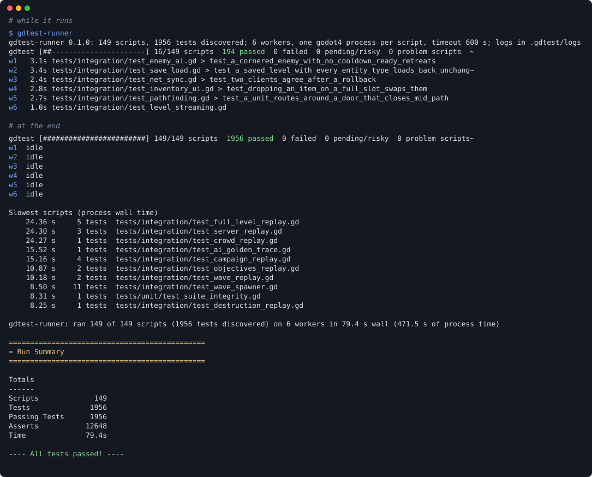

# gdtest-runner

[](https://github.com/thiagossdev/gdtest-runner/actions/workflows/ci.yml)
[](#licence)
[](https://crates.io/crates/gdtest-runner)
[](Cargo.toml)

A parallel test runner for Godot 4 projects that use
[GUT](https://github.com/bitwes/Gut). It works like vitest: it finds your
test scripts without starting Godot, feeds them to a pool of headless
Godot workers from one queue, shows each worker live in the terminal, and
prints a single summary at the end.

On a 149-script, 1956-test suite it cut the run from about 112 s (one GUT
process) to about 37 s on a 6-core machine, with the same per-script counts.
See [Measured results](#measured-results).



## Why

GUT runs every script in one Godot process, one after the other. On a
large suite that leaves most CPU cores idle. Splitting the suite by hand
into shards is fragile: shards go out of balance as tests change, and a
crash in one script takes the rest of its shard down with it.

gdtest-runner keeps GUT as the test framework and changes only how scripts
reach it:

- **A dynamic queue.** Workers pull the next script as soon as they finish.
  The slowest scripts (from the previous run's timings) go first, so the
  run does not end waiting on one long script.
- **Fresh processes.** Each script (or each small batch of scripts) runs in
  its own headless Godot, with its own data dir and port range. A crash or
  a hang costs one script, not the run.
- **Cross-checked verdicts.** A small GDScript reporter streams events from
  inside GUT. The runner checks them against GUT's own summary and against
  a static count of the tests in each file, so a test that silently did not
  run shows up as a `MISMATCH`.
- **Output for people and tools.** A live TUI on a terminal, plain lines in
  a pipe or CI, and a final Run Summary in GUT's own layout, so anything
  that parses GUT output keeps working.

## Requirements

- Linux or macOS. The runner uses Unix process groups and signals, so
  Windows is not supported. CI runs the test suite on both, and runs a real
  headless Godot 4.7.2 + GUT 9.7.1 project on Linux only.
- Godot 4 with a headless-capable binary on `PATH` or given by path.
- GUT 9 vendored in the project (tested with GUT 9.7.1).
- Rust 1.88 or newer to build.

## Install

From [crates.io](https://crates.io/crates/gdtest-runner):

```sh
cargo install --locked gdtest-runner
```

Or download a binary for Linux (x86_64, static) or macOS (Apple Silicon
or Intel) from the
[releases](https://github.com/thiagossdev/gdtest-runner/releases); each
archive also holds the reporter. Or the latest `main`:

```sh
cargo install --locked --git https://github.com/thiagossdev/gdtest-runner
```

Or from a clone:

```sh
git clone https://github.com/thiagossdev/gdtest-runner
cd gdtest-runner
cargo install --locked --path .    # puts gdtest-runner in ~/.cargo/bin
```

## Quick start

1. **Vendor the reporter.** Copy
   [`reporter/gdtest_reporter.gd`](reporter/gdtest_reporter.gd) into your
   project, for example to `res://tools/gdtest/gdtest_reporter.gd`, then let
   Godot import it once so it writes the `.uid` file:

   ```sh
   godot --headless --import
   ```

2. **Write a config** next to your `project.godot`, named `gdtest.toml`:

   ```toml
   reporter = "res://tools/gdtest/gdtest_reporter.gd"
   test_dirs = ["tests/unit", "tests/integration"]
   godot = "godot"
   timings = ".gdtest/timings.tsv"

   [isolation]
   data_dir_var = "XDG_DATA_HOME"
   ```

3. **Run it** from the same folder:

   ```sh
   gdtest-runner              # every test script, 6 workers
   gdtest-runner --list       # what it found, without running anything
   gdtest-runner tests/unit/test_player.gd --workers 1
   ```

[`examples/`](examples/) has a fuller config and the reporter steps for
any GUT project.

## The reporter

[`reporter/gdtest_reporter.gd`](reporter/gdtest_reporter.gd) is a GUT
pre-run hook. The runner passes it to GUT as `-gpre_run_script`; it
connects to GUT's signals and prints one JSON line per event, each after
an `@@gdtest` prefix. The protocol is described in
[docs/reporter-protocol.md](docs/reporter-protocol.md).

If your project already has its own GUT pre-run hook, put it in the
config's `pre_run_script`. The reporter runs it right after attaching and
carries over its abort and exit code.

## Configuration

The config is a TOML file, `./gdtest.toml` by default (`--config FILE`).
`project` is relative to the config file; every other path in it is
relative to the project. Unknown keys are an error, so a typo never falls
back to a default without telling you.

| Key | Default | Meaning |
| --- | --- | --- |
| `project` | `"."` | Folder that holds `project.godot` |
| `godot` | `"godot"` | Godot binary, on `PATH` or a path |
| `godot_args` | `["--headless"]` | Arguments before `-s <gut_cmdln>` |
| `reporter` | required | `res://` path of the vendored reporter |
| `test_dirs` | required | Folders searched recursively for test scripts |
| `workers` | `6` | Parallel Godot processes |
| `script_timeout` | `600` | Seconds one script may run before it is killed |
| `timings` | none | Script timings: queue order in, updated table out |
| `[isolation]` | none | Per-process data dir and port base |
| `[batch]` | none | Which scripts may share a process |

The full reference, with every key, is in
[docs/configuration.md](docs/configuration.md).

## Command line

```text
gdtest-runner [--config FILE] [--workers N] [--timeout SECONDS]
              [--mode auto|script|batch] [--plain | --tui] [--warnings]
              [--timings FILE] [--timings-from FILE]
              [--test-timings FILE] [--log-dir DIR] [--list] [SCRIPT ...]
```

- With no `SCRIPT`, it runs every test script under `test_dirs`. With
  `SCRIPT`s (project-relative or `res://` paths), only those.
- `--list` prints each script with its test count, then the totals, and
  exits.
- `--timings-from FILE` is a second, read-only timings source for scripts
  the main timings file has no row for (a fresh checkout, a scoped run).
- Paths given as flags are relative to the current directory.

## Modes: per script or batch

**Per-script mode** starts one fresh Godot per script. It gives the
strongest isolation: no autoload, static variable or `user://` file can
leak from one script into the next. The cost is Godot's startup, about
1.2 s per process on the machine measured below. For a suite of a few
dozen slow integration scripts that cost hardly matters.

**Batch mode** runs several scripts in one Godot process per worker, as
GUT itself would (`-gtest=a.gd,b.gd,...`), and still gives each script its
own verdict. It pays the startup once per batch, which matters for suites
with many small, fast scripts. A batch takes the next scripts from the
queue up to `max_scripts`, and, with `max_seconds`, up to that many seconds
of previous timings, so slow scripts do not pile into one process.

Scripts in a batch share autoloads, static state and the data dir. Batch
only the scripts you know are safe to run together in any order. Running
the whole suite batched in a shuffled order once is a good way to find the
ones that are not.

`--mode auto` (the default) batches the scripts under `[batch] dirs` and
runs the rest one per process; `--mode script` and `--mode batch` force
one or the other for the whole run.

When a batch's process crashes or times out, the script that was running
gets the `CRASH` or `TIMEOUT`, the scripts that finished keep their own
verdicts, and the scripts that never started go back to the front of the
queue for a fresh process. Every discovered script still runs once.

## Isolation per worker

Parallel Godot processes must not share a `user://` folder or fight over
network ports. The `[isolation]` table names the environment variables
the runner sets for each process:

- `data_dir_var`: gets a fresh, empty temp dir per process, removed
  afterwards. On Linux, Godot puts `user://` under `XDG_DATA_HOME`, so
  `data_dir_var = "XDG_DATA_HOME"` gives every process its own `user://`.
- `port_base_var`: gets `port_base + slot * port_stride`, a port range per
  worker slot. Your tests read the variable and pick ports from it.

Each process runs in its own process group from the project folder. A
timeout kills the whole group, so a child process cannot keep the run
waiting.

## Verdicts

Every script gets one verdict:

| Verdict | Meaning |
| --- | --- |
| `ok` | Every test passed, and the events, GUT's summary and the static count agree |
| `FAIL` | A test failed, or an assert in `before_all`/`after_all` failed |
| `CRASH` | Godot could not start, died by a signal, printed no GUT summary, or exited non-zero with no failing test |
| `TIMEOUT` | The script ran longer than `script_timeout`; its process group was killed |
| `MISMATCH` | The reporter's events, GUT's summary and the static test count disagree, an event line could not be read, or the reporter never reported |

`MISMATCH` is the guard against tests that did not run: a script GUT could
not parse, an inner class it skipped without saying so, or a reporter that
was never vendored. Inherited tests (a test script that extends another
test script) are not followed by the static count; they show up as a
`MISMATCH`, never silently.

GUT warnings and orphan nodes never fail a run. The Run Summary always
prints both totals and names each script with orphans; `--warnings` also
lists the scripts with warnings.

## Timings and queue order

With `timings` set, the runner reads the file before the run and writes it
back after. The queue runs scripts with no timing first (so new scripts
get measured), then the rest slowest first. The file is tab-separated,
with a header row and one row per script (shown here with spaces):

```text
script                                  seconds  tests  asserts
tests/integration/test_save_load.gd     24.360   5      88
```

A run of a subset keeps the rows of scripts it did not run. `test_timings`
writes one row per test (`script`, `test`, `seconds`) for finding slow
tests.

## Output

- **TUI** (stdout is a terminal and `TERM` is not `dumb`): a header with a
  progress bar and counts, one pane per worker with its script, current
  test and time on it, and failures scrolling above as they happen.
- **Plain** (a pipe, a file, CI): one line per finished script with its
  verdict, time, test count and progress, and each problem in full as it
  happens. No escape codes.

`--plain` and `--tui` force either one. Both end with the slowest scripts,
a `ran N of M scripts` line and a Run Summary in GUT's layout. Each script's
stdout and stderr go to `log_dir/<path with / as __>.log` (default
`.gdtest/logs`); a batch also writes its whole log, and each script's log
points at it.

## Exit codes

| Code | Meaning |
| --- | --- |
| `0` | Every discovered script ran and passed |
| `1` | A failing test, a crash, a timeout, a mismatch, fewer scripts run than discovered, or the timings could not be written |
| `2` | A usage or config error |
| `130` | Interrupted by SIGINT or SIGTERM (running processes are killed) |

## Measured results

One machine: 6 physical cores / 12 threads, Linux under WSL2, a Godot 4.8
pre-release build, headless with `--fixed-fps 60`. The suite has 149 GUT
scripts and 1956 tests: 94 small unit scripts and 55 integration scripts,
some of which run full game simulations for several seconds.

| Run | Wall time |
| --- | --- |
| GUT alone, one process, serial | about 111 to 113 s |
| One Godot per script, 6 workers | about 73 to 84 s |
| Every script batched, 5 s budget per batch, 6 workers | about 36 to 38 s |

Batch mode with the 5 s budget, by worker count: 4 workers 46 s, 6 workers
38 s, 8 workers 34 s, 10 workers 30 s.

The 94 small unit scripts alone show the startup cost: one Godot per
script took 34.6 s, batched about 8.5 s, against about 8.4 s for the same
scripts in one serial GUT process. Each fresh Godot costs about 1.2 s
before the first test runs.

Every parallel run reported the same per-script test and assert counts as
the serial run. Details and method: [docs/measurements.md](docs/measurements.md).

## Limitations

- Real Godot runs are tested on Linux only; on macOS only the test suite
  (with a stub Godot) runs in CI. Windows is not supported.
- GUT 9 only. The reporter uses GUT's signals and collected-script objects,
  which may change between GUT versions.
- Static discovery reads files by name and indentation, as GUT collects
  them; it does not follow inherited tests or parameterised tests built at
  runtime. Both show up as a `MISMATCH`.
- Batch mode cannot isolate scripts from each other. Use it only for
  scripts that are safe to share a process.
- In batch mode, GUT names scripts in its orphan report by file name only;
  two batched scripts with the same file name and orphans in one process
  make the batch a `MISMATCH`.
- The runner sets environment variables for isolation; your project has to
  use them (Godot does for `XDG_DATA_HOME` on Linux; ports are up to your
  tests).

## Documentation

- [docs/architecture.md](docs/architecture.md): how discovery, the queue,
  workers, batches, events, verdicts and the summary fit together.
- [docs/reporter-protocol.md](docs/reporter-protocol.md): the reporter's
  JSON-line events.
- [docs/configuration.md](docs/configuration.md): every config key.
- [docs/measurements.md](docs/measurements.md): how the numbers above were
  taken.
- [docs/ci.md](docs/ci.md): what CI checks and how to run the same
  checks locally.
- [docs/versioning.md](docs/versioning.md): what the public API is and
  which changes bump which version number.
- [CHANGELOG.md](CHANGELOG.md)

## Contributing

Issues and pull requests are welcome. See
[CONTRIBUTING.md](CONTRIBUTING.md) for the checks to run and the one rule
that matters most: the runner stays generic, with nothing specific to one
Godot project.

## Licence

Licensed under either of

- Apache License, Version 2.0 ([LICENSE-APACHE](LICENSE-APACHE))
- MIT license ([LICENSE-MIT](LICENSE-MIT))

at your option.

Unless you explicitly state otherwise, any contribution intentionally
submitted for inclusion in the work by you, as defined in the Apache-2.0
license, shall be dual licensed as above, without any additional terms or
conditions.
